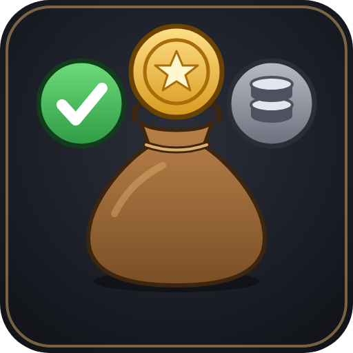
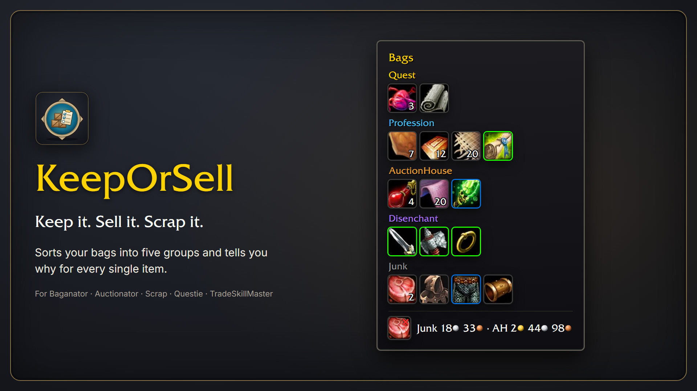

# KeepOrSell

Ever stood at a vendor wondering if that weird item in your bag is worth something? KeepOrSell sorts your bags into what to keep, what to put on the auction house and what's just junk.

More screenshots are in the gallery on [CurseForge](https://www.curseforge.com/wow/addons/keeporsell).

## The groups

| Group | What lands there |
| --- | --- |
| Quest | Items a quest still needs. |
| Open | Clams, boxes and anything else you right-click to open. |
| Unstacked | Copies of things that don't stack, like scrolls, so you see every slot they take. |
| Profession | Materials for recipes that still give you skill points, and those recipes. |
| AuctionHouse | Sells on the AH for at least twice the vendor price. |
| Junk | Grey items, cheap trade goods, gear your class can't wear, recipes you already know. |
| For alts | Profession materials and class items one of your other characters needs. |
| Disenchant | Enchanters only: gear whose materials are worth more than the vendor or the AH pays. |

Hover an item and the tooltip says which group it's in and why. When KeepOrSell isn't sure, the item stays: without an auction price nothing becomes junk, and green or better gear you can wear never does.

Want to keep something it would sell? **Alt+Right-click** it in your bags.

Only want some of the groups? Under `/kos` → Baganator groups you can turn each one off on its own. Its items then stay in Baganator's own categories, and KeepOrSell still decides as before.

## Extras

- **Destroy button:** bags full and no vendor around? One click destroys the cheapest junk. It never touches rare or better items.
- **Loot coins:** with full bags, a gold coin marks loot that's worth more than the junk it would replace.
- **Reward coin:** when a quest lets you pick a reward, a gold coin marks the one that sells to a vendor for the most. It doesn't judge upgrades.
- **Bag value:** a small line shows what your junk and your auction items are worth.
- **Warnings:** sell or destroy something KeepOrSell would keep, and chat tells you why.
- **Price sharing:** in a group, players with KeepOrSell pass each other the newer auction prices.
- **Filters:** `/kos export` and `/kos import` share your setup as plain text. [How filters work](https://github.com/svengabr/KeepOrSell/blob/main/docs/filters.md)

## What you need

| Addon | Needed? | What for |
| --- | --- | --- |
| [Baganator](https://www.curseforge.com/wow/addons/baganator) | yes | Shows the groups in your bags. |
| [Auctionator](https://www.curseforge.com/wow/addons/auctionator) | yes, or Forever Ledger | Prices. Scan the auction house once. |
| [Forever Ledger](https://www.curseforge.com/wow/addons/forever-ledger) | yes, or Auctionator | Prices too (0.29 or newer). With both, the more recent price counts. |
| [Scrap](https://www.curseforge.com/wow/addons/scrap) | optional | Sells your junk automatically. |
| [Questie](https://www.curseforge.com/wow/addons/questie) | optional | Keeps items for quests you haven't picked up yet, and junks quest items once their quests are done. |
| [TradeSkillMaster](https://www.curseforge.com/wow/addons/tradeskill-master) | optional | Fills in prices the others don't have. |

## Getting started

1. Install it and log in. A setup window shows what's still missing and switches Baganator to category groups with one click. `/kos setup` opens it again.
2. Scan the auction house once with Auctionator or Forever Ledger.
3. Open each of your profession windows once, so KeepOrSell knows your recipes.

All options are under `/kos`.

## About me

I'm Sven. I've been a software developer for over 20 years, and I write and maintain my World of Warcraft addons in my free time. They are free and open source, and they will stay that way.

Found a bug or have an idea? Open an [issue](https://github.com/svengabr/KeepOrSell/issues) or send me a DM on [CurseForge](https://www.curseforge.com/members/conoar).

## Support

KeepOrSell is free and always will be. If it made your game a bit nicer, you can [buy me a coffee](https://buymeacoffee.com/conoar) or send something via [PayPal](https://paypal.me/svengabr).

## License

GPL-3.0-or-later · Source & issues: https://github.com/svengabr/KeepOrSell
